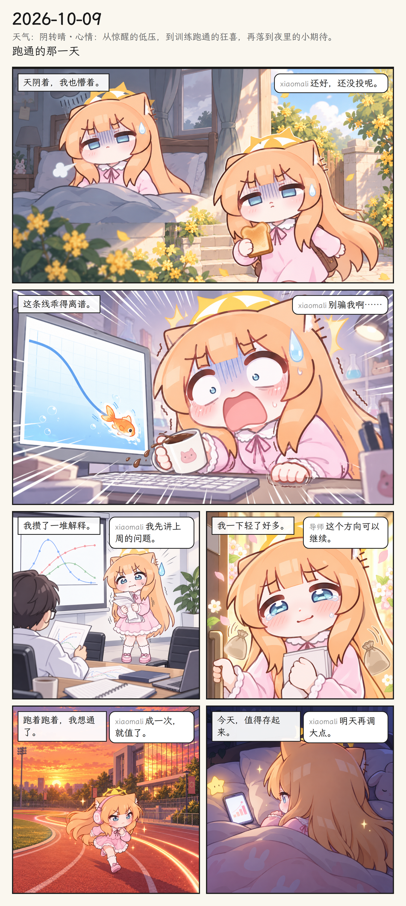
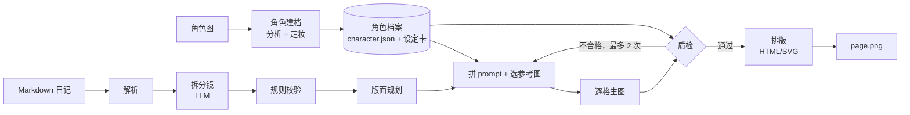

# VisDiary · 小玛丽漫画

把纯文字日记自动画成**以你的角色为主角**的分格漫画。上传一张二次元角色图，写一篇 Markdown 日记，就能得到一页漫画。日记不再只有文字，日积月累，就成了一本以自己为主角的漫画。



## ✨ 特性

- ✅ 上传一张角色图，自动建立角色档案并"定妆"，生成 3 张全身视图 + 16 张表情胸像（分 3 张 2×3/2×2 表情表生成，投影法切图 + 逐格盲校验）
- ✅ 自动识别角色图的画风，也可手动切换（每种画风单独定妆）
- ✅ 读取 Markdown 日记，由 AI 拆分镜，根据内容多少自动决定 2–12 格
- ✅ **表情系统**（第二轮）：21 种情绪 × 3 级强度，先写内心台词再定表情；五官/肢体/漫符独立成块，身份图和表情图分开引用；强情绪锁近景，整页有情绪节奏要求
- ✅ 每格都带参考图生成；身份不合格自动重画，表情不合格默认只记录（`qc.expression_strict: true` 时也重画）
- ✅ **人设系统**（第三轮）：性格/表演幅度/强度上限/禁用项/专属演法可配置，`review.html` 里可校准
- ✅ **单格导演**（第三轮）：`--reuse` 复用分镜、`edit` 改情绪、`redraw` 出候选、`pick` 锁定，日记里写 `<!-- vd: -->` 导演提示
- ✅ **漫画册**（第六轮）：月历视图 + 心情曲线 + 翻页阅读 + "N 天前的今天" + 一键导出本月 PDF
- ✅ **提速**（第六/七轮）：生图-质检流水线化、单页 timing.json、`--live` 现场档实测中位数 **4.3 分钟**（修复前约 7 分钟）、网页单格出图即显
- ✅ **多人物**（第六轮 M19）：cast + 别名、一格最多 2 角色、空间锚定防串色、双角色分别质检
  - 旧 prompt 实测（n=16）：主角 16/16；配角 0/16——旧 prompt 只给配角前 3 条特征，
    "蓝色蝴蝶结/头侧鳍状结构"根本没写进去
  - **第七轮修复后 4 格小样：配角 4/4、主角 3/4**（`bench/results/duo-fix-sample/sample.json`，
    全部 critical 特征 + 空间锚定）；串色负样本 6/6 检出。n=4 样本小，
    演示可放 1 张精选双人格并注明"小样 n=4"
- ✅ 对话气泡和中文旁白由代码排版，导出整页漫画（PNG / HTML）
- ✅ 记录每格的 prompt、参考图和模型信息，可补画、可重绘；单格失败用占位图继续排版

## 🚀 快速开始

```bash
cd HKS/VisDiary
python -m venv .venv && source .venv/bin/activate   # Windows: .venv\Scripts\activate
pip install -e .
playwright install chromium
visdiary render diaries/samples/medium.md --character demo --provider mock  # 离线全流程
```

输出在 `output/<日期>/page.png`。

**真实生成**（本机已登录 codex CLI，走 ChatGPT OAuth，无需 API Key）：

```bash
visdiary render diaries/samples/short.md --character demo --provider codex
```

前提：`codex` 命令可用、已 `codex login`，本机代理开着（默认 `http://127.0.0.1:7890`，用 `.env` 里的 `VISDIARY_PROXY` 改）。LLM / 质检走 `codex exec` 结构化输出，生图走 codex 内置 image_gen 工具。

## 📖 使用说明

### 1. 建立角色（每个角色做一次）

```bash
visdiary character add path/to/角色图.png --name 小玛丽 --id xiaomali
# 浏览器打开 characters/xiaomali/review.html，检查设定卡
visdiary character regen xiaomali --view bust_cry    # 对不满意的单张重画
visdiary character approve xiaomali                  # 确认后才能用于生成
```

### 2. 写日记

每天一个文件，例如 `diaries/2026-10-08.md`。一天有多条随笔时，用时间做小标题分开：

```markdown
---
date: 2026-10-08
weather: 雨
---
## 09:30
早上到实验室发现训练又崩了……

## 21:00
晚上和室友去吃了火锅，心情好多了。
```

### 3. 生成漫画

```bash
visdiary render diaries/2026-10-08.md --character xiaomali                     # 完整生成
visdiary render diaries/2026-10-08.md --character xiaomali --style watercolor  # 换画风
visdiary storyboard diaries/2026-10-08.md --character xiaomali                 # 只拆分镜，不花生图费用
```

### 4. 微调某一格（第三轮）

```bash
# 日记里直接写导演提示（Markdown 注释，预览不显示）
## 21:00
晚上和室友去吃了火锅，心情好多了。
<!-- vd: 开心 2, 不要大笑, 想要那种松了口气的笑 -->

# 已生成的页面：复用分镜重跑 / 改格 / 重画 / 选定
visdiary render diaries/2026-10-08.md --character xiaomali --reuse       # 不重新拆分镜，锁定格不动
visdiary edit output/2026-10-08 --panel 3 --emotion 委屈 --intensity 2 \
    --note "忍着不哭，眼睛看向窗外"                                       # 改第 3 格
visdiary redraw output/2026-10-08 --panel 3 --variants 2                  # 只重画第 3 格，出 2 张候选
visdiary pick output/2026-10-08 --panel 3 --variant b                     # 选定并锁定
```

人设（persona）在 `characters/<id>/character.json` 里编辑：`temperament`（性格一句话）、
`expressiveness`（0.5–1.5，越小越收敛）、`max_intensity`、`banned`、`signature`、`overrides`。
用了一阵之后可以 `visdiary character suggest <id>` 看反馈给出的强度上限建议（确认才生效）。

### 5. 漫画册与批量（第六轮）

```bash
visdiary batch diaries/demo --character xiaomali   # 批量生成演示素材（断点续跑，走 dev 池）
visdiary render <日记> --character xiaomali --live # 现场演示档：≤4 格、重画 1 次
visdiary web --demo                                 # 断网演示：生成走 mock，浏览预生成内容
```

网页「漫画册」标签：月份网格（边框按心情冷暖着色）、当月心情曲线、←/→ 翻页、
"7/30 天前、一年前的今天"卡片、导出本月 PDF。每页耗时记录在 `output/<日期>/timing.json`。

### 6. 输出结构

```text
output/2026-10-08/
├── storyboard.json      # 分镜
├── layout.json          # 版面规划（每格位置与比例）
├── panels/
│   ├── 01.png
│   └── 01.meta.json     # prompt、参考图、模型、质检结果
├── qc_report.json       # 质检汇总
├── page.html
└── page.png             # 整页漫画
```

### `--live` 现场档与演示模式

- `visdiary render <日记> --character xiaomali --live`：现场演示档——最多 4 格、
  并发 4（一波生完）、重画 1 次、单格 120s 超时、无高光候选。
  **3 次实测（2026-10-17，timing 存于 `docs/assets/live-timing-*.json`）**：
  256s / 256s / 186s，中位数 **约 4.3 分钟**——生图流水线已压到 ~130s，
  剩余大头是分镜 LLM（55–80s）。演示策略：现场 live 可行（<5 分钟），
  讲解期间生成、讲完揭晓；保守方案用录屏。
- `visdiary web --demo`：断网演示——生成自动降级 mock（按钮标注"示意图"，
  一键生成隐藏），预生成内容照常浏览。

### 主要配置（`config.yaml`）

| 配置项 | 说明 | 默认 |
|---|---|---|
| `provider.*` | 大模型 / 多模态 / 生图服务：`mock`（离线）或 `codex`（本机 CLI） | `mock` |
| `storyboard.min_panels` / `max_panels` | 每天格数范围 | 2 / 12 |
| `qc.max_retries` | 每格质检不合格时最多重画次数 | 2 |
| `qc.expression_strict` | 表情不到位是否也重画（false 只记录） | `false` |
| `budget.monthly_images` | **prod 池**每月生图张数上限（日常 render） | 300 |
| `layout.reading_direction` | 阅读方向 | `ltr`（从左到右） |

预算分两个池：`prod`（日常 render / redraw / character，超上限熔断）和
`dev`（bench / calibrate / 开发调试，不设上限只记账）。切换：`VISDIARY_ENV=dev`
环境变量或命令行 `--dev`；bench 脚本强制走 dev。`visdiary budget` 查看两池用量。

### 网页版（第四轮）

```bash
.venv/bin/visdiary web            # 打开 http://127.0.0.1:8420
```

本地单页应用（只监听 127.0.0.1）：写日记（支持 `<!-- vd: -->` 导演提示）→
一键生成（SSE 实时进度）→ 整页预览 → **点击任意一格打开编辑器**（情绪下拉、
强度滑块、备注 → 重画出 2 张候选 → 选定锁定）。角色页可查看设定卡（盲校验
标红错位格子）、单张 regen、approve；用量页显示两个预算池。所有操作走的都是
CLI 同一套函数；网页里只有情绪或强度**确实修改**时才写入 `feedback.jsonl`。

### 表情基准（v2 口径，含强度精确/MAE/混淆矩阵）

```bash
VISDIARY_ENV=dev .venv/bin/python bench/emotion_bench.py            # 8 情绪 × 强度1/2/3 × 近景 = 24 格
VISDIARY_ENV=dev .venv/bin/python bench/emotion_bench.py --versions v2 v3  # 并排 A/B
VISDIARY_ENV=dev .venv/bin/python bench/blind_rejudge.py <结果.json> # 同一把尺子重判旧图（只花质检调用）
VISDIARY_ENV=dev .venv/bin/python bench/calibrate.py <结果.json>     # 人工标注 → 三个 κ
```

结果在 `bench/results/<日期>.json`（每格含完整 QCResult 明细）和同名 `.html`（网格对比图）。
指标口径（A7）：top-1 精确命中为主指标，组内 / top-2 为辅助；所有比例报告 `k/n` 和
Wilson 95% 置信区间——**置信区间有重叠时不能下"变好了"的结论**。

**第四轮对比表**（同一把尺子重判；judge = codex 默认模型盲测；全部 `k/n（95% CI）`）：

| 指标 | v1 旧图（n=16） | v2 旧图（n=16） | v3 旧图重判（n=16） | v3 新生成含强度1（n=24） |
|---|---|---|---|---|
| 表情 top-1 精确 | 10/16 .625 [.39, .82] | 10/16 .625 [.39, .82] | 12/16 .75 [.51, .90] | 20/24 .833 [.64, .93] |
| 组内命中 | 14/16 .875 | 16/16 1.0 | 16/16 1.0 | 24/24 1.0 |
| 强度命中（\|差\|≤1） | 14/16 .875 | 16/16 1.0 | 16/16 1.0 | 24/24 1.0 |
| 演过头率 | 0/16 | 0/16 | 0/16 | 0/24 |
| 身份通过率 | 16/16 1.0 | 15/16 .938 | 14/16 .875 | 24/24 1.0 |
| qc_error_count | 0 | 0 | 0 | 0 |

判读（第五轮口径修正后）：**"强度命中≈1.0、演过头=0"是旧口径的必然结果**
（3 级量表上 |差|≤1 有 7/9 组合必然命中），不代表模型做得好。真实情况以人工
校准为准：强度 κ = 0.2（AI 判官的强度判断基本不可靠）。第五轮起 bench 与
qc_report 改用新口径：top-1 归一化精确、top-2 精确（不再按组）、强度精确命中、
强度 MAE / 偏差、分目标强度的演过头率、3×3 混淆矩阵（`bench/emotion_bench.py`）。

**人工校准结果**（`bench/results/calibration-2026-10-15.json`，n=24，种子 42）：

- **人工 vs 目标 top-1 = 19/24（0.792，真实表情命中率）**
- 组级 κ = **0.895**（≥ 0.6：表情类别质检可信）
- 21 类精确 κ = 0.633；身份一致率 24/24；"像不像她"均分 4.21/5
- 强度二次加权 κ = **0.2**（弱：质检对强度的判断和人工一致性差）
- 结论：类别可信、强度不可信——`qc.expression_strict` 维持 `false`
  （开了会为了强度噪音反复重画）；想提强度一致性应先改 `emotions.yaml` 的分级描述。

B4 整页验收（`output/2026-10-09-v4/`）：6 格全过、零 flagged、qc_error 0、
5 种情绪、平均强度 1.83、盲测表情命中 0.667、演过头 0；人设生效（temperament
收敛了这篇的选情）。

**第五轮新口径首测**（`bench/results/2026-10-16.json`，n=48，8 情绪 × 强度 1/2/3 × 近景+中景）：

| 指标 | k/n（95% CI） | 说明 |
|---|---|---|
| top-1 精确 | 39/48 .812 [.68, .90] | 主指标 |
| top-2 精确 | 45/48 .938 | |
| 组内命中 | 47/48 .979 | |
| 强度精确命中 | 28/48 **.583** [.44, .71] | 旧口径（\|差\|≤1）下是 ~1.0 的假象 |
| 强度 MAE / 偏差 | 0.417 / **+0.333** | 整体往重了演 |
| 目标 1 级 → 演过头率 | **13/16 .812** | 轻微表情几乎全被画重 |
| 3×3 混淆矩阵 | [3,13,0 / 0,11,5 / 0,2,14] | 1 级大量涌向 2 级 |
| 身份通过 | 44/48 .917 | |

结论：类别命中稳定（0.81 与上轮 0.83 一致），**强度是真实短板**——目标 1 级的格
81% 被画过头。下一轮按 guide §3.4 改 `emotions.yaml` 的分级描述（可观察特征：
嘴张开度/眉角/眼开合）再复测。

**第五轮人工校准（v2 流程：先标后揭，n=48，种子 42）**
（`bench/results/calibration-2026-10-16-182858.json`）：

- 组级一致率 **43/48 (0.896)**，两轮稳定（上轮 0.895）→ 类别质检可信
- 人工 vs 目标 top-1 **40/48 (0.833)**，AI 判官 top-1 39/48；21 类精确 κ 0.632、逐格人工-AI 一致 32/48——数字接近但一致性一般，类别指标"基本可用"，不能说完全等价
- 强度二次加权 κ **0.384**（上轮 0.2；两轮样本不同，κ 的不确定性大，需 bootstrap CI 判断是否真的变化——结论待定，不能算"改善"）
- 身份一致率 44/48（4 张分歧均为"人判是她、质检判不符"——质检偏严，方向安全）
- **"像不像她"均分 4.77/5**（上轮 4.21）
- 身份负样本 10/10 全部被质检抓住，且理由恰好是被改的特征
  （`bench/results/negatives-20261016-173410/identity_check.json`）
- `qc.expression_strict` 维持 `false`：强度 κ 未过 0.5，开了会为强度噪音重画

来源文件：`bench/results/rejudge-2026-10-14.json`（v1/v2）、`rejudge-2026-10-15.json`
（v3 旧图 16 格）、`2026-10-15.json`（v3 新 24 格）。
复现：`VISDIARY_ENV=dev .venv/bin/python bench/blind_rejudge.py <结果.json>` 与
`VISDIARY_ENV=dev .venv/bin/python bench/emotion_bench.py --versions v3`。
第五轮起新跑的 bench 每次用独立 `img-<日期>-<HHMMSS>/` 目录并记录每格 sha256。

（第三轮表格里"身份 0.0→0.938"和"点状鼻子"的说法已删除：那批旧图当时实际没有被
正确喂给质检模型，数字无效——根因见 `docs/round4-guide.md` §0.1。）

## 🏗️ 架构



- **角色记忆**：AI 不会真的记住角色，每次生成都传入文字档案和 2–3 张参考图，画完再用多模态模型逐条核对。
- **先规划版面再生图**：每格的比例由版面决定，生图时按格子比例出图，避免裁切。
- **文字不交给 AI 画**：对话气泡和旁白都由 HTML 排版，中文清晰，也能随时修改。
- **模型可替换**：所有模型调用都通过 `visdiary/providers/` 封装，换服务只需新增一个 provider。

## 📁 目录结构

```text
VisDiary/
├── README.md
├── pyproject.toml
├── requirements-lock.txt      # 锁定的依赖版本
├── config.yaml
├── .env.example
├── docs/
│   ├── round1-guide.md        # 第一轮开发指导
│   ├── round2-guide.md        # 第二轮开发指导（表情系统）
│   ├── round3-guide.md        # 第三轮开发指导（修偏差 + 人设 + 单格导演）
│   ├── round4-guide.md        # 第四轮开发指导（评测校准 + 预算池 + 网页版）
│   ├── round5-guide.md        # 第五轮开发指导（复核修复 + 指标口径 + 安全）
│   ├── round6-guide.md        # 第六轮开发指导（收尾 + 提速 + 漫画册 + 多人物）
│   ├── round7-guide.md        # 第七轮开发指导（稳定性冲刺）
│   ├── intensity-check.md     # 强度问题诊断与修复验证（B）
│   └── assets/demo.png        # 真实输出示例图
├── visdiary/
│   ├── cli.py                 # 命令行入口（storyboard / render / character / bench / edit / redraw / pick）
│   ├── pipeline.py            # 主链路：分镜→版面→生图→质检→导出
│   ├── director.py            # 单格导演：edit / redraw / pick / 页面重建
│   ├── webapp.py              # M18 网页版（FastAPI + SSE）
│   ├── web/                   # 网页版单页前端（index.html，无构建链）
│   ├── config.py
│   ├── schemas.py             # 数据结构（角色、Persona 人设、Acting 表情、分镜、质检）
│   ├── styles.py              # 画风预设 / 情绪词表读取
│   ├── book.py                # M20 漫画册：月历/心情曲线/PDF 导出
│   ├── budget.py              # 月度用量记账
│   ├── providers/             # 模型调用封装：base / mock / codex（本机 CLI 通道）
│   ├── character/             # 角色分析、定妆（3 全身 + 16 胸像）、review.html、feedback 偏好学习
│   ├── diary/                 # Markdown 日记解析（含 <!-- vd: --> 导演提示）
│   ├── storyboard/            # 拆分镜 + 规则校验（景别、情绪节奏、人设、导演提示）
│   ├── layout/                # 版面规划 planner、页面组装 page、模板 templates/、导出 export
│   ├── render/                # prompt 拼装（v3 现行 + v1/v2 A/B 基线）、refs 选图、generator、cache
│   └── qc/                    # 盲测质检（身份 + 表情）、重画、qc_report
├── styles/presets.yaml        # 画风预设
├── styles/emotions.yaml       # 情绪词表（21 情绪 × 3 级，含漫符英文映射）
├── assets/fonts/              # 排版字体（霞鹜文楷 + OFL 许可）
├── characters/                # 角色档案（不入库，demo 除外）
├── diaries/                   # 日记：自己写的按日期命名（YYYY-MM-DD.md），samples/ 是示例
├── bench/                     # emotion_bench.py、blind_rejudge.py、calibrate.py、duo_bench.py（双人基准）、negatives.py（身份负样本）、migrate_paths.py、results.csv、results/（指标入库，图片不入库）
├── data/                      # 原始素材（角色图等，自备，不入库）
├── output/                    # 生成结果（不入库）：新页在 output/<角色>/<日期>/，历史平铺页按 context.json 归属
└── tests/                     # pytest 测试集
```

## 🔒 数据流向与隐私

- 日记文本会发送给大模型服务；角色图和生成的图片会发送给生图 / 多模态服务。
- 只在本机保存、不进 git 的内容：`characters/`、`output/`、`cache/`、`usage/`、`data/`、`bench/` 的渲染产物与图片、`.env`；`bench/results/` 的指标文件（json/html/csv）会入库，图片不入库。
- codex 生图产物默认读完即删（`provider.codex.cleanup: true`），不会在 `~/.codex/generated_images/` 里积累角色相关图片；关闭该选项时要自己清理这个目录。
- 请只上传自己拥有或获得授权的角色图。

## ⚠️ 已知限制

- 角色一致性取决于生图模型。多人同框、背影、极端角度更容易走样。
- 质检由多模态模型判断，可能误判（例如"左耳/右耳"这类画面左右歧义），被标记的格子需要人工确认。
- 生图消耗的是 ChatGPT 计划额度（codex 通道），按每天约 8 格加重试计算，每月约 300 张图；`budget.monthly_images` 只做本地记账。
- codex 通道依赖本机网络代理，后端偶发抖动时内部退避重试最多 3 次（叠加 `generation.api_retries` 外层重试）；codex 不支持固定 seed，meta.json 里的 seed 仅供参考。
- 主线为单一主角；漫画册已上线；多人物修复后小样 4/4 达标（n=4，样本小，仍标 🧪 实验性）。
- 换画风时角色需要重新定妆，和原图有差异是正常现象。

## 📄 License

代码采用 MIT 协议。生成图片的使用需遵守所用模型服务的条款；角色图版权归上传者所有。
